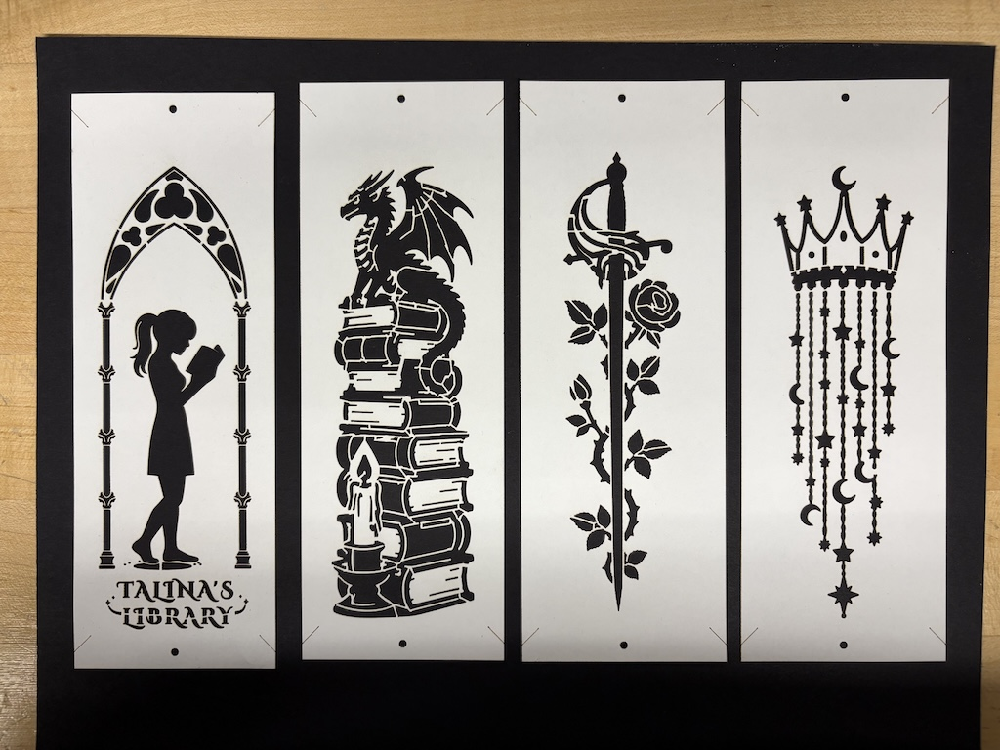

# Laser Cut Bookmark Set

## Design one

Use a single sheet of material, engrave and mark the graphics on both sides, and cut the perimeter and tassel hole.

### Material options
* Single layer of [cream 400 GSM cardstock](https://www.amazon.com/dp/B0FJR3CL9V).
* [Maple veneer](https://www.etsy.com/listing/1657356808/cricut-maker-explore-thin-wood-veneer).

### Cutting alignment
* Engrave one side.
* Cut out the ribbon hole and the outer perimeter.
* Make a jig using a piece of cardboard. Cut out a 50mm x 150mm hole.
* Without moving the jig, put the bookmark in the hole, back side up.
* Engrave the back side.
* If the jig has been moved after cutting the hole, I can also reposition the (0, 0) position of the laser head to the upper left corner of the hole.
  
### Trial runs

#### Chip board, bookmark, 40W cutter
Done on some cheap 0.4mm chipboard. 

##### Settings (40W)
* #00FF00, Engraving: P100 S100
* #0000FF, Marking: P10 S60
* #FF0000, Cutting: P40 S50

##### Results:

##### Observations
* There was some burning and charring going on. I probably should lower the power and increase the speed. But it should not be a problem for high quality cardstock.
* The threshold of the arch consists of two long horizontal lines spanning almost the whole width. This weakens the paper. The final product will not be as bad. But I decided to replace the threshold with a shadow to signify that she's grounded.

#### Cardstock
Found it in the makerspace. So I decided to give it a try. It's about 0.38 mm in thickness. 

##### Settings (60W)
* #00FF00, Engraving: P50, S100 
* #0000FF, Marking: P6, S100
* #FF0000, Cutting: P10, S35

# Design two
Three cardstock sheets sandwiched together. For this design, we cut out the graphics on top and bottom sheets, glue them to the core, and then cut. So the graphics need to be modified to eliminate islands. E.g. the inside of letters A and O.

I worked with Claude back and forth multiple rounds to nail down the following graphics.

I cut two registration holes to help visually align the three sheets; I also marked the four corners to guide cutting later.

## Materials
* Front and back: [Navy Blue 225 gsm](https://cardstock-warehouse.com/products/navy-blue-lessebo-colours-cardstock)
* Core: [Gold Metallic 285 gsm](https://cardstock-warehouse.com/products/gold-metallic)
* Glue: 3M 77

## Process
* Cut the top and bottom sheets.
* Cut the core sheet.
* Glue three sheets together, using the resitration holes to align them.
* Cut the laminated sandwich. Use one of the guide marks on the corners to zero the laser head.

#### Gluing
* Use parchment paper as the base.
* Put front and back sides on the paper.
* Spray 3M 77 from 10-12 inches away.
* Wait for 30-60 seconds, lift both sides, assemble the core.
* Put the sandwich under weight, separated by parchment paper.
* Cure for at least 15 mintues.

# Sleeves
I also decided to make a nice sleeve for the bookmark set. It's basically two pieces of paper glued together. One piece has three glue flaps that are folded. I marked the fold lines to avoid cracking and to provide a precise folding position.

## Materials

### Option 1 (fail)
Black 400 GSM cardstock. 

#### Settings (60W)
* #0000FF, Marking: P8 S100
* #FF0000, Cutting: P30 S50

#### Observations
* The cardstock is too thick to fold. If I mark too deep, I risk the flap falling off. If I mark too shallow, it'd be too hard to fold. When it does, it gets fuzzy at the fold and it cracks.
* It's also too stiff. It's impossible to open and insert the bookmarks.

### Option 2 (satisfactory)
I found some black sheets in the makerspace. They are about 0.23mm in thickness. So I gave it a try.

#### Settings (60W)
* #0000FF, Marking: P4 S 100
* #FF0000, Cutting: S18 P 50

#### Observations
* The thickness seems to be just right
* The paper itself is not dyed through. The cut edges show a little charring.
