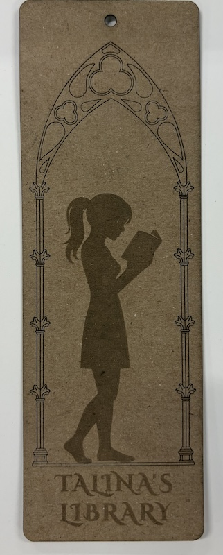
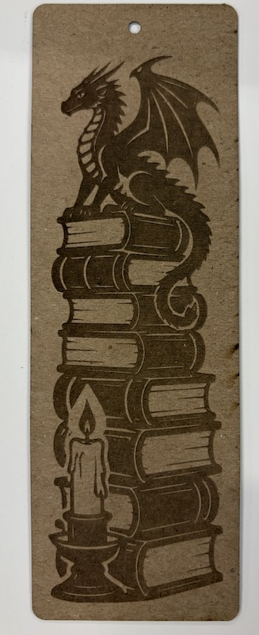
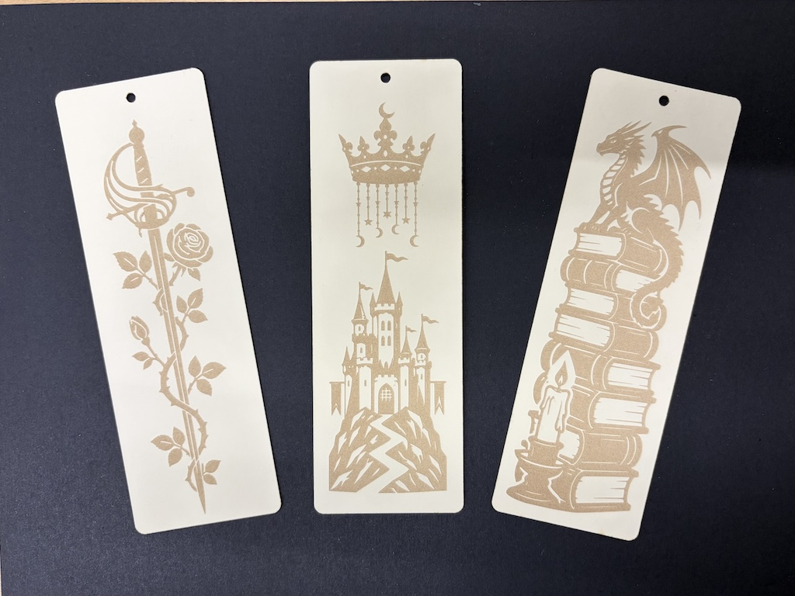
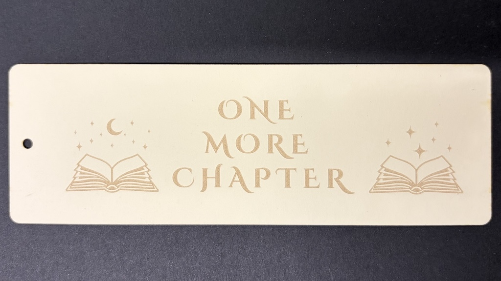
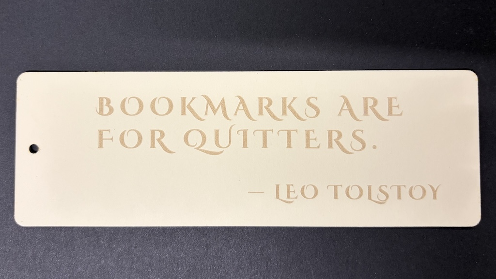
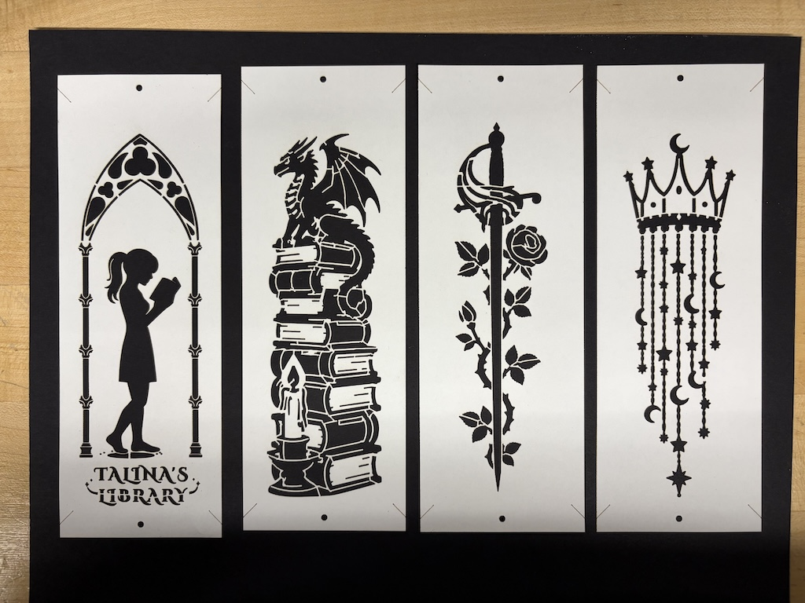
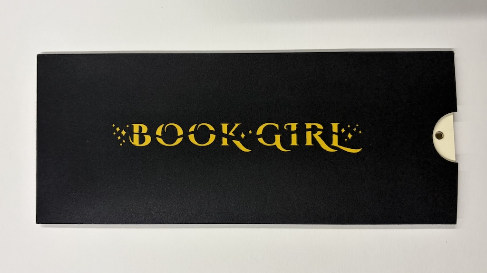
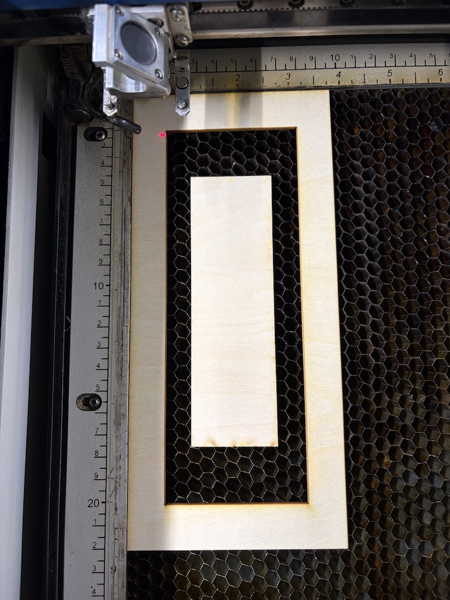

# Laser Cut Bookmark Set

## Design one

Use a single sheet of material, or two layers laminated together, engrave and mark the graphics on both sides, and cut the perimeter and tassel hole.

### Alignment
* Use [drafting tape](https://www.amazon.com/dp/B00GHSMNPY) to tape the cut line on both sides to prevent burn marks.
* Cut the tassle hole and the perimeter; remove the tape carefully.
* Make a jig using a piece of plywood. Cut out a 50mm x 150mm hole (no rounded corners).
* Tape the engraving jig to the honeycomb; set origin to upper left of the rectangular hole.
* Drop the piece into the hole, engrave.
* Flip and engrave the back side.
* Be careful that the piece could get hot after engraving. Give it some time to cool down between two sides.

### Material options
* Single layer of [cream 400 GSM cardstock](https://www.amazon.com/dp/B0FJR3CL9V).
* Double layer of the same cardstock.
* [Maple veneer](https://www.etsy.com/listing/1657356808/cricut-maker-explore-thin-wood-veneer).
  
### Trial runs

#### Chip board, bookmark, 40W cutter
Done on some cheap 0.4mm chipboard. 

##### Settings (40W)
* #00FF00, Engraving: P100 S100
* #0000FF, Marking: P10 S60
* #FF0000, Cutting: P40 S50

##### Results:

##### Observations
* There was some burning and charring going on. I probably should lower the power and increase the speed. But it should not be a problem for high quality cardstock.
* The threshold of the arch consists of two long horizontal lines spanning almost the whole width. This weakens the paper. The final product will not be as bad. But I decided to replace the threshold with a shadow to signify that she's grounded.

#### Two layers of 400 GSM cardstock
I experimented with a single sheet. And I found it a little too thin. So I tried glueing two sheets together.

##### Settings (60W)
* #00FF00, Engraving: P50, S100 
* #0000FF, Marking: P8, S100
* #FF0000, Cutting: P22, S100: *Two passes*

##### Observations
Two layers turned out to be too thick. I am also not very happy with the color. I wish it were a little more yellow.

#### Two layers of ivory cardstock
As luck would have it, I found a bunch in the makerspace with the ideal color. Weight unknown. 8 sheets measure 3mm. Should be 300 - 325 GSM, according to Gemini. It has a yellowish cream color, very much like French vanilla ice cream. It's probably marketed as "butter cream" or "banada split".

##### Settings (60W)
* #00FF00, Engraving: P50, S100 
* #0000FF, Marking: P8, S100
* #FF0000, Cutting: P30, S100: *Two passes*

#### Results:
The results are just perfect. I decided to make a bonus fun one too.

## Design two
Three cardstock sheets sandwiched together. For this design, we cut out the graphics on top and bottom sheets, glue them to the core, and then cut. So the graphics need to be modified to eliminate islands. E.g. the inside of letters A and O.

I worked with Claude back and forth multiple rounds to nail down the following graphics.

I cut two registration holes to help visually align the three sheets; I also marked the four corners to guide cutting later.

### Materials
* Front and back: [Navy Blue 225 gsm](https://cardstock-warehouse.com/products/navy-blue-lessebo-colours-cardstock)
* Core: [Gold Metallic 285 gsm](https://cardstock-warehouse.com/products/gold-metallic)
* Glue: 3M 77

### Process
* Cut the top and bottom sheets.
* Cut the core sheet.
* Glue three sheets together, using the resitration holes to align them.
* Cut the laminated sandwich. Use one of the guide marks on the corners to zero the laser head.

#### Gluing
* Use parchment paper as the base.
* Put front and back sides on the paper.
* Spray 3M 77 from 10-12 inches away.
* Wait for 30-60 seconds, lift both sides, assemble the core.
* Put the sandwich under weight, separated by parchment paper.
* Cure for at least 15 mintues.

## Sleeves
I also decided to make a nice sleeve for the bookmark set. It's basically two pieces of paper glued together. One piece has three glue flaps that are folded. I marked the fold lines to avoid cracking and to provide a precise folding position.

### Materials

#### Option 1 (fail)
Black 400 GSM cardstock. 

##### Settings (60W)
* #0000FF, Marking: P8 S100
* #FF0000, Cutting: P30 S50

##### Observations
* The cardstock is too thick to fold. If I mark too deep, I risk the flap falling off. If I mark too shallow, it'd be too hard to fold. When it does, it gets fuzzy at the fold and it cracks.
* It's also too stiff. It's impossible to open and insert the bookmarks.

#### Option 2 (good)
Black 80 lb cardstock from Amazon

##### Settings (60W)
* #0000FF, Marking: P5 S100
* #FF0000, Cutting: P25 P100

##### Observations
* The thickness seems to be just right
* The paper itself is not dyed through. The cut edges show a little charring.

### Materials for backing

##### Settings (60W)
* #FF0000, Cutting: P15 P100

#### Glue
To glue the backing to the top sheet, I first tried PVA glue. It worked. But there were a few issues:

* It's messy
* It dries slowly
* It warps the paper noticeably

Then I tried a Kores glue stick. After a few tries, I managed to do it very clean and the result was perfect.

#### Result

## Jigs

### Cutting

To avoid burn marks at the bottom, I used the following jig . I used a piece of plywood and cut a channel along the final cut line. Then put the piece on top. This way, the cut line will be in the air. Before the actual cutting, do a dry run without the piece to make sure the whole cut line falls on the honeycomb, not the plywood.

### Backside alignment

Since I am engraving on both sides, I need to make sure that when I flip the piece, its origin is still aligned. I take a piece of plywood, tape it to the bed, cut a hole exactly the size of the bookmark. Then I drop the piece into the hole, backside up. As long as the plywood has not moved, its origin should be aligned for the backside. If it has moved, it's pretty easy to reposition the origin to the upper left corner of the rectanglular hole.