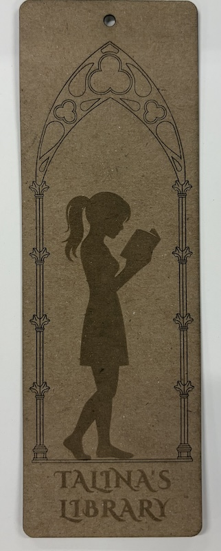
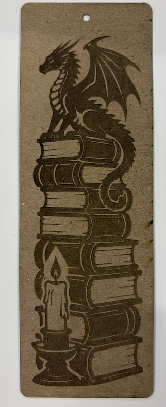

# Design

Front:
Back:
Sleeve:

# Bookmarks

## Materials

### Option 1
Single layer of [black 400 GSM cardstock](https://www.amazon.com/dp/B0G6455XRB).

### Option 2
[Maple veneer](https://www.etsy.com/listing/1657356808/cricut-maker-explore-thin-wood-veneer).

### Option 3
Three cardstock sheets sandwiched together.

* Front and back: [Navy Blue 225 gsm](https://cardstock-warehouse.com/products/navy-blue-lessebo-colours-cardstock)
* Core: [Gold Metallic 285 gsm](https://cardstock-warehouse.com/products/gold-metallic)
* Glue: 3M 77

### Gluing

* Use archment paper as the base.
* Put front and back sides on the paper.
* Spray 3M 77 from 10-12 inches away.
* Wait for 30-60 seconds, lift both sides, assemble the core.
* Put the sandwich under weight, separated by parchment paper.
* Cure for at least 15 mintues.

# Cutting alignment

* Engrave one side.
* Cut out the ribbon hole and the outer perimeter.
* Make a jig using a piece of cardboard. Cut out a 50mm x 150mm hole.
* Without moving the jig, put the bookmark in the hole, back side up.
* Engrave the back side.
  
# Trial runs

## Chip board, bookmark, 40W cutter

Done on some cheap 0.4mm chipboard. 

### Settings (40W)

* #00FF00, Engraving: P100 S100
* #0000FF, Marking: P10 S60
* #FF0000, Cutting: P40 S50

### Results:

### Observations

* There was some burning and charring going on. I probably should lower the power and increase the speed. But it should not be a problem for high quality cardstock.

* The threshold of the arch consists of two long horizontal lines spanning almost the whole width. This weakens the paper. The final product will not be as bad. But I decided to replace the threshold with a shadow to signify that she's grounded.

## Cardstock

Found it in the makerspace. So I decided to give it a try. It's about 0.38 mm in thickness. 

### Settings (60W)

* #00FF00, Engraving: P50, S100 
* #0000FF, Marking: P6, S100
* #FF0000, Cutting: P10, S35

# Sleeves

Mark the fold lines to avoid cracking and to provide a precise folding position.

## Materials

### Option 1
Black 400 GSM cardstock. 

#### Settings (60W)
* #0000FF, Marking: P8 S100
* #FF0000, Cutting: P30 S50

#### Observations
* The cardstock is too thick to fold. If I mark too deep, I risk the flap falling off. If I mark too shallow, it'd be too hard to fold. When it does, it gets fuzzy at the fold and it cracks.
* It's also too stiff. It's impossible to open and insert the bookmarks.

### Option 2
I found some black sheets in the makerspace. They are about 0.23mm in thickness. So I gave it a try.

#### Settings (60W)
* #0000FF, Marking: P4 S 100
* #FF0000, Cutting: S18 P 50

#### Observations
* The thickness seems to be just right
* The paper itself is not dyed through. The cut edges show a little charring

### Option 3